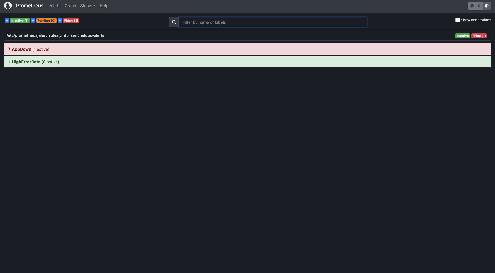
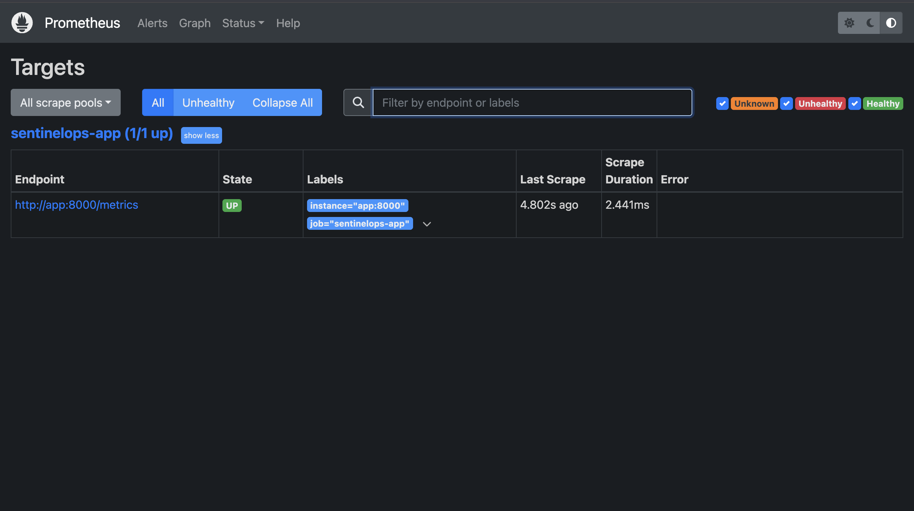

# SentinelOps AI

AI-powered cloud security and reliability platform for small teams (work in progress).

## What it does

Monitors an application, detects failures, and raises alerts. Self-healing, security checks and ML anomaly detection are planned in later stages.

## Architecture

```
Developer -> GitHub -> GitHub Actions (lint, test, Docker build, smoke test)

Terraform -> Azure: resource group, VNet, subnet, NSG (firewall), Linux VM

On the VM (Docker Compose):
  FastAPI app (/health, /metrics)  <-  Prometheus (alert rules)  <-  Grafana (dashboard)
```

## Tech stack

Python (FastAPI), Docker, Docker Compose, GitHub Actions, Prometheus, Grafana, Terraform, Microsoft Azure

## Run it locally

```bash
docker compose up -d --build
```

- App: http://localhost:8000/health
- Prometheus: http://localhost:9090
- Grafana: http://localhost:3000

## Deploy to Azure

The infrastructure lives in `infra/` and is created with Terraform:

```bash
cd infra
export ARM_SUBSCRIPTION_ID=$(az account show --query id --output tsv)
export TF_VAR_my_ip="$(curl -s https://ifconfig.me)/32"
terraform init
terraform apply
```

Then SSH to the VM, install Docker, clone this repo and run `docker compose up -d --build`.

Remove everything when finished: `terraform destroy`

## Security and cost controls

- The firewall (NSG) only allows SSH and the app ports from my own IP address
- Login to the VM uses an SSH key, with no password
- A monthly budget alert is set on the Azure subscription
- The VM shuts down automatically at 11 PM
- Resources are destroyed after every session

## Screenshots

Grafana dashboard:


Alert firing when the app goes down:



Running on an Azure VM:



## Progress

- [x] Stage 1: Dockerized FastAPI app with health and metrics endpoints
- [x] Stage 2: CI pipeline with GitHub Actions
- [x] Stage 3: Prometheus monitoring, alert rules and Grafana dashboard
- [x] Stage 4: Terraform infrastructure and deployment to an Azure VM (app setup on the VM is still manual)
- [ ] Stage 5: Self-healing (auto-restart / rollback)
- [ ] Stage 6: Security checks (misconfiguration detection, secret scanning)
- [ ] Stage 7: ML anomaly detection and plain-language alert explanations
