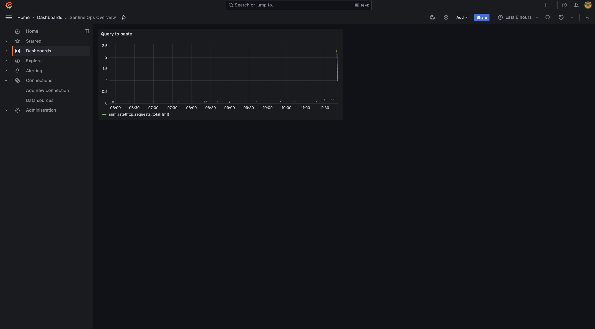

# SentinelOps AI

AI-powered cloud security and reliability platform for small teams (work in progress).

## What it does

Monitors an application, detects failures, and raises alerts. Security checks, self-healing and ML anomaly detection are planned in later stages.

## Architecture

```
Developer -> GitHub -> GitHub Actions (lint, test, Docker build, smoke test)

Docker Compose:
  FastAPI app (/health, /metrics)  <-  Prometheus (scrapes every 5s, alert rules)  <-  Grafana (dashboard)
```

## Tech stack

Python (FastAPI), Docker, Docker Compose, GitHub Actions, Prometheus, Grafana

## Run it locally

```bash
docker compose up -d --build
```

- App: http://localhost:8000/health
- Prometheus: http://localhost:9090
- Grafana: http://localhost:3000

## Screenshots

Grafana dashboard:



Alert firing when the app goes down:


## Progress

- [x] Stage 1: Dockerized FastAPI app with health and metrics endpoints
- [x] Stage 2: CI pipeline with GitHub Actions
- [x] Stage 3: Prometheus monitoring, alert rules and Grafana dashboard
- [ ] Stage 4: Terraform and deployment to Azure
- [ ] Stage 5: Self-healing (auto-restart / rollback)
- [ ] Stage 6: Security checks (misconfiguration detection, secret scanning)
- [ ] Stage 7: ML anomaly detection and plain-language alert explanations
